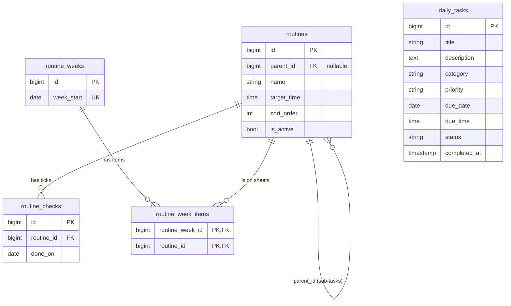

# Database Design

The BrainHub app tables, their columns, and how they connect.
(The Laravel default tables `users`, `sessions`, `cache` and `jobs` are left out.)

## Key terms

| Term | Meaning | Example |
|---|---|---|
| **Primary key (PK)** | "Who am I?": the row's own unique number | `routines.id` |
| **Foreign key (FK)** | "Who do I belong to?": holds another row's `id` | `routine_checks.routine_id` → `routines.id` |
| **Pivot table** | A middle table with two FKs, used for many-to-many | `routine_week_items` |
| **Self-reference** | An FK that points to its own table | `routines.parent_id` → `routines.id` |

## Diagram



Plain-text version:

```
routine_weeks (id) ──< routine_week_items >── routines (id) ──< routine_checks (routine_id)
                                                 │  ▲
                                                 └──┘ parent_id (sub-tasks)

daily_tasks: standalone, no relations
```

`──<` means one-to-many: one row on the left, many rows on the right.

---

## Tables

### 1. `daily_tasks`: one-off tasks (page 1)

| Column | Type | Rules | Purpose |
|---|---|---|---|
| id | bigint | PK | |
| title | string | required | |
| description | text | nullable | |
| category | string | nullable | office, learning, personal |
| priority | string | default `medium` | high, medium, low |
| due_date | date | indexed | which day the task belongs to |
| due_time | time | nullable | |
| status | string | default `pending`, indexed | pending, in_progress, completed |
| completed_at | timestamp | nullable | set when the task is completed |
| created_at / updated_at | timestamp | | |

No relations.

### 2. `routines`: the habit list (page 2)

| Column | Type | Rules | Purpose |
|---|---|---|---|
| id | bigint | PK | |
| parent_id | bigint | FK → `routines.id`, nullable, cascade delete | `NULL` = top-level routine; a value = sub-task of that routine |
| name | string | required | |
| target_time | time | nullable | used for sorting (e.g. 06:00) |
| sort_order | unsigned int | default 0 | order of sub-tasks |
| is_active | boolean | default true | deactivate instead of delete |
| created_at / updated_at | timestamp | | |

Index: `(is_active, parent_id)`, for the query "active top-level routines".

Sample:

| id | parent_id | name |
|---|---|---|
| 1 | NULL | Wake up |
| 2 | NULL | Exercise |
| 3 | 2 | 20 push-ups |
| 4 | 2 | 2 km run |

### 3. `routine_weeks`: one weekly sheet

| Column | Type | Rules | Purpose |
|---|---|---|---|
| id | bigint | PK | |
| week_start | date | **unique** | the Monday of the week, so there is one sheet per week |
| created_at / updated_at | timestamp | | |

### 4. `routine_week_items`: which routines are on which sheet (pivot)

| Column | Type | Rules |
|---|---|---|
| routine_week_id | bigint | FK → `routine_weeks.id`, cascade delete |
| routine_id | bigint | FK → `routines.id`, cascade delete |

- **Primary key = `(routine_week_id, routine_id)`**, so a routine can appear on a sheet only once.
- No `id` column, because the pair of ids already identifies the row.
- Only **top-level** routines are added. Their sub-tasks come along through `parent_id`.

Sample: sheet 7 contains Wake up and Exercise.

| routine_week_id | routine_id |
|---|---|
| 7 | 1 |
| 7 | 2 |

### 5. `routine_checks`: one row per tick

| Column | Type | Rules | Purpose |
|---|---|---|---|
| id | bigint | PK | |
| routine_id | bigint | FK → `routines.id`, cascade delete | what was done |
| done_on | date | | which day |
| created_at / updated_at | timestamp | | |

**Unique `(routine_id, done_on)`**: a routine can be ticked only once per day.

- **Tick** = insert a row.
- **Untick** = delete the row.
- **Only leaf routines are ticked** (no sub-tasks). A parent's status is calculated from its children.

---

## Relationships (migration → Eloquent)

| Database link | Model method | Type | Example |
|---|---|---|---|
| `routines.parent_id` → `routines.id` | `Routine::parent()` | belongsTo | `$run->parent` → Exercise |
| (same column, other side) | `Routine::children()` | hasMany | `$exercise->children` → push-ups, run |
| `routine_checks.routine_id` → `routines.id` | `RoutineCheck::routine()` | belongsTo | `$check->routine` → Wake up |
| (same column, other side) | `Routine::checks()` | hasMany | `$wake->checks` → all ticks |
| `routine_week_items` (2 FKs) | `RoutineWeek::routines()` | belongsToMany | `$sheet->routines` → Wake up, Exercise |
| (same pivot, other side) | `Routine::weeks()` | belongsToMany | `$wake->weeks` → every sheet it is on |

How to choose the relationship type:

- The model whose table **has** the `xxx_id` column → `belongsTo`.
- The other side → `hasMany`.
- Many on both sides → a pivot table with two FKs → `belongsToMany` on both models.

## Cascade deletes

| Delete this… | …and the database also deletes |
|---|---|
| a routine | its sub-tasks, its ticks, its rows in `routine_week_items` |
| a weekly sheet | its rows in `routine_week_items` (the routines and ticks stay) |

## Known gaps

- **No `user_id`** on any app table: all users share the same tasks and routines. Each table needs a `user_id` FK before real multi-user use.
