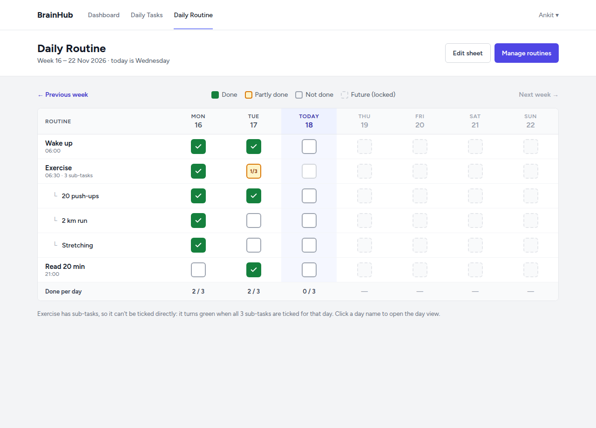

# 2️⃣ Daily Routine

**Status:** ⏳ Not started · **Branch:** `feature/daily-routine` · **Depends on:** Daily Tasks done

## Goal

Track repeating routines (e.g. "Wake up at 6:00", "Exercise") on a **weekly sheet**: tick each day's boxes, see one day's progress, and look back at old weeks.

## User stories

- As a user, I can create routine items, optionally with a target time and **sub-tasks** (e.g. Exercise → push-ups, run, stretching).
- As a user, I can create **this week's sheet** by copying last week's routines, then add or remove items.
- As a user, I can tick and untick a routine (or sub-task) for **today or any earlier day of this week**.
- As a user, a routine with sub-tasks is **done automatically** when all its sub-tasks are ticked.
- As a user, I can open **one day** and see what I completed (e.g. "2 of 3 done").
- As a user, I can open **old weeks' sheets** (read-only).

---

## UI

**Mockups** (open the `.html` files in a browser; screens link to each other): [`02-daily-routine-mockups/`](02-daily-routine-mockups/)

| Screen | Image | Page |
|---|---|---|
| Week sheet | [week-sheet.png](02-daily-routine-mockups/week-sheet.png) | [week-sheet.html](02-daily-routine-mockups/week-sheet.html) |
| Day view | [day-view.png](02-daily-routine-mockups/day-view.png) | [day-view.html](02-daily-routine-mockups/day-view.html) |
| Create & edit sheet | [create-edit-sheet.png](02-daily-routine-mockups/create-edit-sheet.png) | [create-edit-sheet.html](02-daily-routine-mockups/create-edit-sheet.html) |
| Manage routines | [manage-routines.png](02-daily-routine-mockups/manage-routines.png) | [manage-routines.html](02-daily-routine-mockups/manage-routines.html) |



### Week sheet — `/routine-weeks/{week}`

```text
Week 16–22 Nov 2026     ◀ previous week   [ Edit sheet ]     next week ▶

                         Mon   Tue   Wed   Thu   Fri   Sat   Sun
⏰ Wake up 6:00            ✅    ✅    ☐     ·     ·     ·     ·
🏃 Exercise                ✅    🟡    ☐     ·     ·     ·     ·
     ├─ 20 push-ups        ✅    ✅    ☐     ·     ·     ·     ·
     ├─ 2 km run           ✅    ☐     ☐     ·     ·     ·     ·
     └─ Stretching         ✅    ☐     ☐     ·     ·     ·     ·
📖 Read 20 min             ☐     ✅    ☐     ·     ·     ·     ·
                          2/3   2/3   0/3
```

- ✅ done · 🟡 parent partly done (some sub-tasks) · ☐ not done (clickable) · `·` future day (locked)
- Clicking a day header opens the **day view** for that date.
- Old weeks show the same grid, read-only.

### Day view — `/routine-weeks/{week}?day=2026-11-17`

```text
Tuesday 17 Nov — 2 of 3 done
✅ Wake up 6:00
🟡 Exercise (1 of 3 sub-tasks)
✅ Read 20 min
```

### Other screens

| Screen | Content |
|---|---|
| `/routines` | Redirects to this week's sheet; if it does not exist yet → "Create this week's sheet" button |
| Edit sheet | Checkbox list of active routines → choose which are in this week |
| Manage routines | List, add, edit, deactivate routine items and sub-tasks |
| Old weeks | List of past sheets → open read-only |

---

## Data model

**Key ideas**

1. A routine is defined **once**; each **tick** is a separate row (routine + date). No daily reset job — a new day simply has no rows yet.
2. A **sheet** is one week (starts **Monday**) and holds **which routines** are tracked that week.
3. Sub-tasks are routines with a **parent**. A parent's status is **computed** from its sub-tasks, never stored.

```text
routines (parent_id → routines)          routine_weeks
   │  ▲ self-reference                       │
   │  └── sub-tasks                          │
   ├──────────── routine_week_items ─────────┘   (which routines are in which week)
   │
   └──< routine_checks                           (one row per routine ticked on a date)
```

### `routines` — the reusable item

| Column | Type | Rules |
|---|---|---|
| `id` | bigint | Primary key |
| `parent_id` | foreignId, nullable | → `routines.id`; `null` = top-level item, set = sub-task. **One level only.** |
| `name` | string | Required, e.g. "Exercise" |
| `target_time` | time, nullable | Optional, e.g. 06:00 (used for sorting) |
| `sort_order` | integer | Default 0 (order of sub-tasks / items with the same time) |
| `is_active` | boolean | Default true — deactivate instead of deleting, so history stays |
| `created_at`, `updated_at` | timestamps | Laravel |

### `routine_weeks` — the weekly sheet

| Column | Type | Rules |
|---|---|---|
| `id` | bigint | Primary key |
| `week_start` | date, **unique** | Always a **Monday** |
| `created_at`, `updated_at` | timestamps | Laravel |

### `routine_week_items` — pivot: routines on a sheet

| Column | Type | Rules |
|---|---|---|
| `routine_week_id` | foreignId | → `routine_weeks.id`, cascade on delete |
| `routine_id` | foreignId | → `routines.id`, cascade on delete |

Primary/unique key: (`routine_week_id`, `routine_id`). Only **top-level** routines are stored; their active sub-tasks come with them.

### `routine_checks` — one row per tick

| Column | Type | Rules |
|---|---|---|
| `id` | bigint | Primary key |
| `routine_id` | foreignId | → `routines.id`, cascade on delete |
| `done_on` | date | The day it was done |
| `created_at`, `updated_at` | timestamps | Laravel |

Unique index: (`routine_id`, `done_on`) — a routine can be ticked only once per day.
Checks are stored only for **leaf** items (routines with no sub-tasks).

---

## Routes (inside `auth`)

| Action | HTTP | URL | Method |
|---|---|---|---|
| Entry point → this week | GET | `/routines` | `RoutineWeekController@current` |
| Old weeks list | GET | `/routine-weeks` | `RoutineWeekController@index` |
| Create this week's sheet (copy last week) | POST | `/routine-weeks` | `RoutineWeekController@store` |
| Week sheet (+ `?day=` day view) | GET | `/routine-weeks/{week}` | `RoutineWeekController@show` |
| Edit sheet items | GET / PUT | `/routine-weeks/{week}/edit` · `/routine-weeks/{week}` | `edit` · `update` |
| Manage routines | resource | `/routines/manage…` | `RoutineController` (`index`, `create`, `store`, `edit`, `update`, `destroy`) |
| Tick | POST | `/routine-checks` | `RoutineCheckController@store` |
| Untick | DELETE | `/routine-checks/{check}` | `RoutineCheckController@destroy` |

---

## Business rules

1. A week starts on **Monday**. One sheet per week (`week_start` unique).
2. **Create sheet** copies the previous sheet's routines (only those still active); the user can then add or remove items.
3. A **leaf** routine can be ticked for **today or an earlier day of the current week**. Future days are locked; **old weeks are read-only**.
4. A routine can be ticked **once per day** (unique index + validation).
5. A **parent** is done on a day when **all** its active sub-tasks are ticked that day; partly done when some are. Parents with sub-tasks cannot be ticked directly.
6. Day progress = done top-level items ÷ top-level items on that week's sheet.
7. Deleting a routine = **deactivate** (`is_active = false`): it leaves future sheets but old sheets and checks keep it.
8. Sub-tasks are one level deep (a sub-task cannot have sub-tasks).

---

## Laravel concepts in this page

Self-referencing relationship (`parent` / `children`) · `belongsToMany` with a custom pivot table and `sync()` · foreign keys with `cascadeOnDelete()` · composite unique index · Carbon `startOfWeek(Carbon::MONDAY)` · eager loading nested relations (`routines.children.checks`) to avoid N+1 · computed status (model method) · Form Request rules for dates (`before_or_equal:today`) · `boolean` cast

---

## Implementation checklist

| Step | Work | Status |
|---|---|---|
| A | Migrations (4 tables), models, relationships, factories | ⏳ |
| B | Manage routines: CRUD for items and sub-tasks (Form Requests), deactivate | ⏳ |
| C | Create this week's sheet (copy last week) + edit sheet items (`sync()`) | ⏳ |
| D | Week sheet grid: rows, 7 days, computed parent status, locked future days | ⏳ |
| E | Tick / untick (rules 3–5) | ⏳ |
| F | Day view + progress | ⏳ |
| G | Old weeks list + read-only sheet | ⏳ |
| H | "Daily Routine" in the navigation | ⏳ |
| I | Feature tests for every rule | ⏳ |

---

## Acceptance criteria

- [ ] Routine items and sub-tasks can be created, edited and deactivated.
- [ ] This week's sheet can be created from last week and its items changed.
- [ ] Today and earlier days of this week can be ticked/unticked; future days and old weeks cannot.
- [ ] A parent shows done only when all its sub-tasks are done that day.
- [ ] The day view shows what was completed on that date.
- [ ] Old weeks can be opened read-only.
- [ ] A routine cannot be ticked twice on the same day.
- [ ] Feature tests pass in CI.

## Out of scope (v1)

Morning/evening groups (items are sorted by target time instead), sub-tasks more than one level deep, streaks and charts, reminders, editing old weeks.
